  

  <a href="https://www.linkedin.com/in/abdurrehmanfarooqi/"><b>LinkedIn</b></a> &nbsp;·&nbsp;
  <a href="#selected-work"><b>Project highlights</b></a> &nbsp;·&nbsp;
  <a href="#opportunities"><b>Work with me</b></a>

## Across web, mobile, and desktop

I’m **Abdur Rehman Farooqi**, a full-stack and frontend developer. I build application interfaces and the APIs and data workflows behind them. My work includes attendance and payroll systems, desktop point-of-sale software, mobile apps, and responsive websites.

I'm currently a Full-Stack Developer at **Global Connect Synergy (GCS)**. Previously, I worked at Cygnis and Futech Solutions. I care about clear interfaces, reliable data handling, and the details that make an application easier to use.

## What I work with

| Area | Technologies |
| --- | --- |
| Frontend | React, Next.js, JavaScript, TypeScript, Tailwind CSS |
| Backend | Node.js, Express, REST APIs |
| Mobile & desktop | React Native, Expo, Electron |
| Data | PostgreSQL, Prisma, SQLite, MongoDB |

## Selected work

| Project | My contribution |
| --- | --- |
| **TrackMe** | Attendance and payroll features across a Next.js admin portal and a React Native/Expo app, with supporting API and database workflows. |
| **POS System** | Desktop point-of-sale workflows for inventory, purchasing, expenses, and restaurant orders using Next.js, Electron, Prisma, and SQLite. |
| **Pitchfound** | Full-stack development, responsive interfaces, performance improvements, and AI-assisted content-generation workflows. |
| **Sitaar** | Interfaces for an AI music app, including a Howler.js audio player, prompt-based music creation, and track management. |
| **ApnaPlaza** | Work across website, dashboard, and backend applications, using Node.js, Express, and MongoDB on the backend. |
| **[The Creative Unit](https://www.thecreativeunit.com/)** | A responsive corporate website with attention to navigation, performance, and mobile usability. |
| **[Fleck Publisher](https://fleckpublisher.com/)** | A publishing-services website with service pages, lead-generation forms, FAQs, and mobile-friendly layouts. |
| **[Velivs](https://velivs.com/)** | A Next.js and TypeScript website, with work on SEO, analytics integration, and contact features. |

## Opportunities

I'm interested in full-stack and frontend roles in Karachi, remote work with Pakistan-based or international teams, and overseas roles with relocation support.

If you're hiring or working on a project that fits, [let's connect on LinkedIn](https://www.linkedin.com/in/abdurrehmanfarooqi/).
